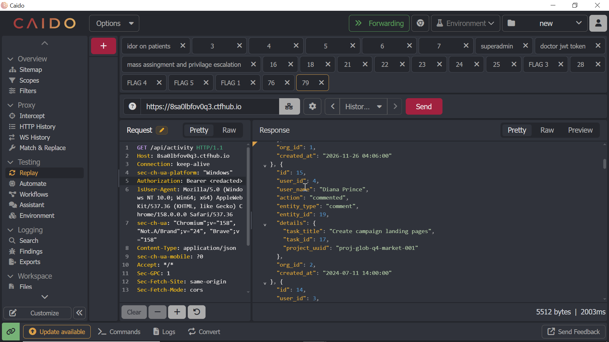

# T-02: Unscoped Activity Feed — Cross-Organization Data and UUID Leak

- **CWE:** CWE-639 (IDOR) / Missing Tenant Scope on Aggregation Endpoint
- **OWASP:** A01:2021 Broken Access Control
- **Endpoint:** `GET /api/activity`
- **Severity:** High
- **CVSS 3.1:** `AV:N/AC:L/PR:L/UI:N/S:C/C:H/I:N/A:N` — 8.2

## Summary

This is a broader and more severe info leak than T-01. `/api/activity` is an org-wide activity/audit-log feed that aggregates events (comments, task updates, file uploads, project creation) across the system. As a single authenticated user, I received entries tagged with **multiple different `org_id` values in the same response** — meaning this endpoint hands over a feed of everything happening across every organization, with zero fuzzing or guessing required.

## Steps to Reproduce

```http
GET /api/activity HTTP/1.1
Authorization: Bearer <redacted>
```

Response (200 OK) contained entries mixing `org_id: 1` and `org_id: 2` in the same payload, each with `user_id`, `user_name` (e.g. "Diana Prince"), `entity_type`, `entity_id`, and nested `details` (task IDs, task titles, project UUIDs).

Pulling the full response and mapping every distinct `org_id` present confirmed:

- **org_id 1 — "Acme":** users Alice Johnson, Bob Smith. Projects: `proj-acme-web-redesign-001`, `proj-acme-mobile-app-002`
- **org_id 2 — a second org:** users Charlie Brown, Diana Prince. Projects: `proj-glob-data-plat-002`, `proj-glob-intern-tool-003`, `proj-glob-q4-market-001`

The feed also exposed:
- **Invited-user emails from outside the org** (e.g. `newdev@acme.com`, `consultant@external.com`), along with the role they were invited as
- **File upload metadata** hinting at sensitive content, including a filename `credentials-staging.env` — even without fetching the file itself, the existence and naming of a credentials file for another org is a disclosure on its own
- A flag confirming the leak, embedded in an `uploaded_file` activity entry for that same file: `FLAG{activity_feed_cross_org_leak}`

No pagination or date-range parameter was required — the entire history (IDs 1 through 22, across both orgs) returned in one call with no filtering applied by default.

## Impact

This is a materially worse leak than a single-object IDOR for three reasons:

1. **No enumeration needed** — a single request hands over a cross-org activity dump, rather than requiring an attacker to guess IDs one at a time.
2. **It leaks PII** — real names tied to real actions, across organizations the caller has no relationship to.
3. **It leaks identifiers useful for further attacks** — `task_id`, `project_uuid`, and `user_id` values belonging to other orgs are handed over for free, which is exactly what enabled T-03 (a UUID-based endpoint that should otherwise have resisted guessing).

## Root Cause

Same family as T-01 — missing tenant scope — but at the aggregation layer instead of a single-object lookup. The activity log query either omits a `WHERE org_id = :current_org` clause entirely, or the underlying activity_log table was never designed with tenant partitioning in the first place.

## Remediation

- Scope the activity feed query by the caller's `org_id`, same as any other tenant-scoped resource.
- Audit every aggregation/search/export endpoint in the app for the same omission — these "sleeper" endpoints often reuse a generic query builder that was never updated with the tenant filter applied to direct-lookup endpoints.
- Avoid returning full historical dumps with no pagination by default; cap default results and require explicit date ranges for bulk exports.

## Evidence



