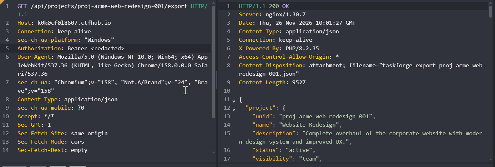

# T-03: UUID-Based IDOR on Project Export — Exploited via T-02's Leaked UUIDs

- **CWE:** CWE-639 (IDOR) / CWE-863 (Incorrect Authorization) — noted here specifically as "Authorization Bypass Through User-Controlled Key" with a UUID rather than a sequential integer
- **OWASP:** A01:2021 Broken Access Control
- **Endpoint:** `GET /api/projects/{uuid}/export`
- **Severity:** High
- **CVSS 3.1:** `AV:N/AC:L/PR:L/UI:N/S:C/C:H/I:N/A:N` — 8.2

## Summary

Unlike T-01 and T-02, this endpoint's resource identifier is a real UUID (`7c9e6679-...`), not a guessable sequential integer. On its own, that should make brute-forcing infeasible. **The only reason this was exploitable is that T-02's activity feed leaked the UUID directly** — proving that UUIDs are not a substitute for an authorization check, only a (much weaker) substitute for one.

## Vulnerability Chain

```
T-02 (activity feed, unscoped, leaks UUIDs) 
  → T-03 (export endpoint, authz check missing, but normally "protected" by UUID-as-secret) 
  → Full project + org data exfiltration
```

## Steps to Reproduce

1. From T-02's activity dump, obtained a project UUID belonging to the other org: `proj-glob-q4-market-001`, underlying UUID `7c9e6679-...`.
2. Requested the export endpoint for that project, authenticated as my own (different) org's account:
   ```http
   GET /api/projects/proj-glob-q4-market-001/export HTTP/1.1
   Authorization: Bearer <redacted — my own org's token>
   ```
3. Response (200 OK) returned the **full project object**, nesting:
   - The organization object itself (`uuid`, `name: "Globex Inc"`)
   - Full project metadata
   - A `tasks` array with presumably every task under that project

4. Confirmed this wasn't project-specific by testing the other two org-2 project UUIDs obtained from the same activity dump (`proj-glob-data-plat-002`, `proj-glob-intern-tool-003`) — both also exported successfully.

## Impact

A single authenticated request, using a UUID obtained from an unrelated leak, exfiltrates another organization's full project record — its identity (name, UUID), every task under it, and (per the chain with T-02) likely references to uploaded files such as the `credentials-staging.env` file flagged earlier. This confirms the UUID "protection" on this endpoint is fully defeated once the ID is known by any means, and the endpoint itself performs no independent ownership check.

## Root Cause

The export endpoint checks "does a project with this UUID exist," exactly like T-01's integer-ID lookup, just with a different ID format. **UUID-based IDs only raise the bar to guessing — they do not replace an authorization check.** Since this app's own activity feed leaks UUIDs it shouldn't, the "unguessable ID" protection provides effectively no real security here.

## Remediation

- Add the same tenant-scope check here as recommended in T-01/T-02: `WHERE project_uuid = ? AND org_id = ?`, regardless of whether the ID is sequential or a UUID.
- Treat "the ID is a UUID" as *never* sufficient justification to skip an authorization check in code review — this finding is good evidence for that policy.
- Fix T-02 first (or in the same pass), since this endpoint's real-world exploitability depends entirely on UUIDs being discoverable elsewhere in the app.

## Evidence



